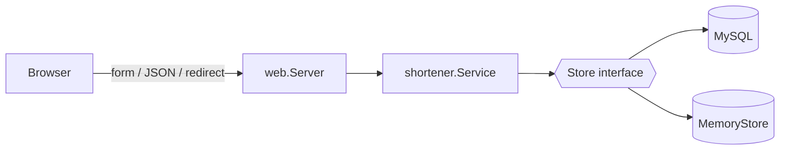

# URL Shortener (Go)

A beginner-friendly URL shortener written in **Go** using only the standard library for the web server
(`net/http`, `html/template`, `database/sql`, `embed`) plus the official **MySQL driver**.
Create short links, look them up, get redirected, and see click counts.

## Features
- Shorten a URL from an **HTML form** or a **JSON API**
- Random 7-character codes (crypto-secure, no look-alike characters like `0/O` or `1/l`) or a **custom code**
- `GET /{code}` redirects (HTTP 302) and **counts the click** atomically in SQL
- Stats page per link and a "recent links" table on the home page
- URL validation (only `http`/`https`; `example.com` becomes `https://example.com`)
- Safe by default: `?` placeholders in every SQL query and auto-escaped HTML templates
- Can run without MySQL using `STORE=memory`

## Architecture
```
cmd/server/main.go            reads config, opens MySQL, starts the HTTP server
internal/shortener/           core logic (no HTTP)
    link.go                   Link type, errors, Store interface
    service.go                validation, code generation, click counting
    mysql_store.go            Store backed by MySQL (database/sql)
    memory_store.go           Store backed by a map + mutex (tests / demo)
internal/web/                 HTTP layer
    handlers.go               routes, HTML + JSON handlers, error mapping
    templates/, static/       HTML and CSS embedded into the binary with go:embed
```

Because handlers depend on the `Store` **interface**, the tests run the real handlers on the in-memory store.

### Endpoints
| Method | Path | Description |
|---|---|---|
| GET | `/` | Home page with form and recent links |
| POST | `/shorten` | Form submit |
| GET | `/{code}` | Redirect to the original URL (+1 click) |
| GET | `/stats/{code}` | Stats page |
| POST | `/api/links` | JSON `{"url": "...", "code": "optional"}` -> 201 with `shortUrl` |
| GET | `/api/links/{code}` | JSON details including `clicks` |

## How to run
Requirements: Go 1.22+ and Docker.
```bash
docker compose up -d          # MySQL with db/schema.sql loaded
go run ./cmd/server           # http://localhost:8080
```
Or without a database:
```bash
STORE=memory go run ./cmd/server
```
Environment variables: `PORT`, `BASE_URL`, `DB_DSN` (default
`shortener:shortener@tcp(localhost:3306)/shortener?parseTime=true`), `STORE`.

Try the API:
```bash
curl -X POST localhost:8080/api/links -d '{"url":"https://www.griffith.ie","code":"griffith"}'
curl -i localhost:8080/griffith
curl localhost:8080/api/links/griffith
```

## How to test
```bash
go test ./...
go test -race ./...     # also checks for data races
```
- `service_test.go` - table-driven URL validation, custom codes, collision retry, click counting,
  100 concurrent clicks
- `handlers_test.go` - JSON API, redirects, status codes (400/404/409), HTML form flow, XSS escaping, static files

## Possible improvements
- Link expiry dates, QR codes, rate limiting, user accounts, a Dockerfile for the Go server.
